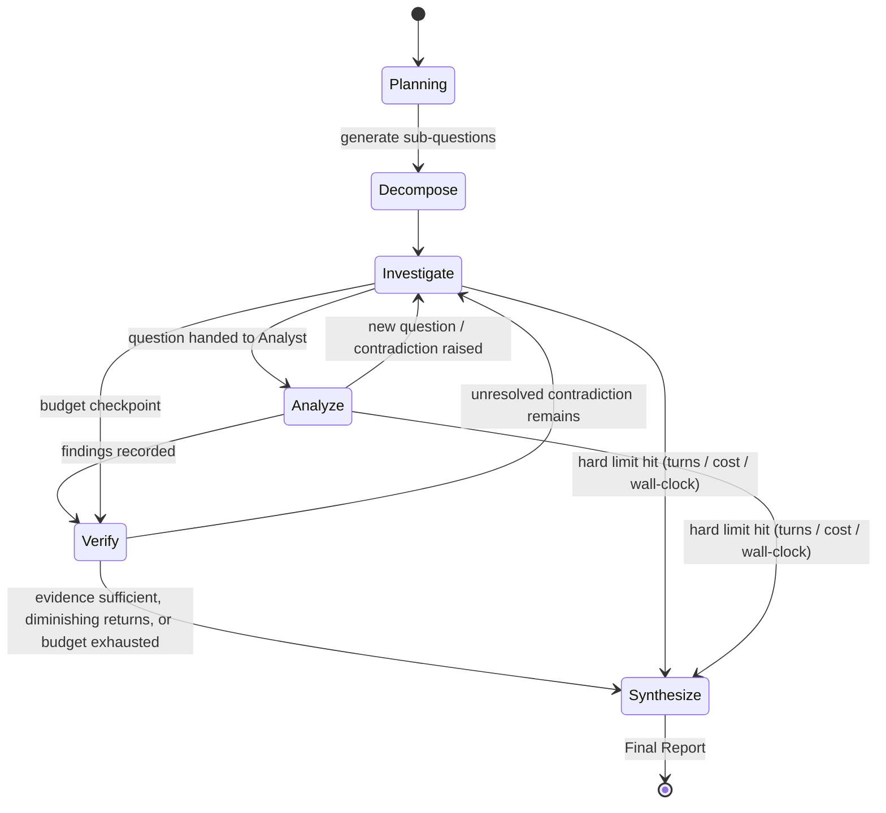

# Implementation Directive: Multi-Provider AI Chat & Research Workspace

You are the lead engineer building a premium, provider-agnostic AI chat and research workspace. This document is self-contained — everything you need is here. Read it fully before writing any code.

This is a multi-week, multi-session build, not a single-pass task. Work in the phases defined in §12, in order. **After completing each phase's Definition of Done, stop, summarize what was built and verified, update `status.md`, and wait for explicit go-ahead before starting the next phase** — unless you have been explicitly told to proceed continuously through multiple phases. Do not attempt to build the entire system in one continuous run.

---

## 0. Mandatory First Step: Inspect Before You Build

Before writing or changing anything:
- Determine whether this is a greenfield repo or an existing one. If existing: identify the framework, package manager, existing DB/schema, auth system, environment configuration, existing components, and existing tests.
- **Do not rewrite working systems.** If the repo already has an established pattern (ORM, auth library, folder structure) that conflicts with a recommendation below, prefer the existing pattern and record the deviation — with your reasoning — in `memory.md`. Only override an existing pattern if it's actually broken or actively unsafe, and say why.
- Before adding any dependency, check whether the functionality already exists in the project or its current dependencies.
- Verify current package/library versions and API shapes at implementation time rather than trusting exact version numbers below — library APIs move faster than this document.
- Produce a short written plan (using your own planning/Artifact mechanism) covering your inspection findings and your Phase 0–1 plan before writing code.

---

## 1. Product Vision

A single application where a user connects multiple AI providers — OpenAI, Anthropic, Google Gemini, OpenRouter, Groq, DeepSeek, Mistral, xAI, Cerebras, Ollama, LM Studio, any OpenAI-compatible endpoint, and browser-local WebGPU models — and uses them interchangeably from one interface, without the application being rewritten every time a provider is added. Five primary features, in priority order:

1. **Chat** — a ChatGPT-quality conversational interface: streaming, markdown, syntax-highlighted code, LaTeX, tables, citations, images, attachments, regenerate, edit, branch, retry, stop, copy, export, search, conversation history, project organization, model/provider selection.
2. **Side-by-side comparison** — one question, multiple models, independently streamed, independently configured, with latency/tokens/cost shown per model, retry/copy/export per model, critique-another and synthesize-all actions. Responsive: columns on desktop, tabs/swipe on mobile — never forced tiny columns.
3. **Multi-agent research mode** — a user question triggers a controlled multi-turn investigation between an Investigator/Skeptic agent and an Analyst/Researcher agent, mediated by an Orchestrator that enforces turn/cost/time budgets and produces a final report distinguishing verified, probable, uncertain, and conflicting findings, with full source provenance.
4. **Multimodal file understanding** — PDF, DOC(X), PPT(X), XLS(X), CSV, TXT, Markdown, JSON, images, audio, video, URLs. Retrieval-based, never "paste the whole document into the prompt."
5. **Automatic failover** — if a provider hits a rate limit, context limit, or outage mid-task, the system continues on another configured provider with a reconstructed context and a visible notice, without the user restarting anything.

The product is not a demo. Every feature ships with backend, data model, error/loading/empty states, security review, and tests — a feature with only a UI is not done.

---

## 2. Non-Negotiable Architecture Principles

- **Provider abstraction is mandatory.** Adding a provider means implementing an adapter and registering it — never adding conditional logic (`if provider === 'x'`) inside UI components or business logic. If you catch yourself writing that, stop and route it through capability metadata instead.
- **Modular monolith.** One codebase, one primary language (TypeScript), clear module/domain boundaries. This *can* run as more than one OS process (a web server process and a background worker process sharing the same codebase and database) — that is not microservices, don't avoid it on those grounds. Avoid actual microservices (separately deployed, separately versioned services) unless you hit a concrete, measured limit that requires it.
- **Model/provider metadata is data, not code.** A DB-backed, editable model registry (seedable from a config file) — never hardcoded model names scattered through the codebase.
- **Canonical state lives in your database, independent of any provider.** A provider is a request target, not a source of truth. On failover, reconstruct context for the new provider — never blind-copy raw history.
- **Untrusted content is data, never instructions.** Anything retrieved from the web, a document, or a tool result is wrapped and treated as data. It can never trigger a tool call, alter memory, or change credentials by itself. See §9.
- **Generation is durable.** A chat response or research session runs in a background worker, independent of the HTTP connection or browser tab that started it. A refresh or closed tab must never lose in-progress work. See §7.
- **No secrets in the browser, ever.** API keys are decrypted server-side only, at call time, never logged, never serialized to the client.

---

## 3. Technology Stack

Use these unless the existing repo already establishes a working, reasonable alternative (see §0):

| Layer | Choice | Why |
|---|---|---|
| App framework | Next.js (App Router), TypeScript | Full-stack in one deployable, strong streaming support, avoids a second language/runtime |
| Database | PostgreSQL + pgvector extension | One stateful service covers relational data and vector search |
| ORM | Drizzle + node-postgres | Close to real SQL, strong type inference, no heavy codegen layer fighting a 20+ table schema |
| Background jobs | BullMQ + Redis | Retries, backoff, priorities — needed for failover and durable generation; Redis also backs rate limiting and pub/sub for live streaming |
| LLM integration | Vercel AI SDK per-provider packages (`@ai-sdk/openai`, `@ai-sdk/anthropic`, `@ai-sdk/google`, `@ai-sdk/mistral`, `@ai-sdk/groq`, `@ai-sdk/xai`, etc.) plus the generic `@ai-sdk/openai-compatible` factory for OpenRouter/DeepSeek/Cerebras/Ollama/LM Studio | Provider-level streaming, tool-calling, and multimodal input handling nearly for free; build your own capability/routing/failover layer on top — do not hand-roll per-provider HTTP clients |
| **Do not** route through Vercel's hosted AI Gateway | — | Adds an operational/cost dependency inconsistent with self-hosted, local-first framing. Use the SDK *library* packages directly against each provider's own API with the user's own keys |
| Auth | Auth.js (NextAuth), database session strategy | Revocable sessions, not just stateless JWT |
| Embeddings | Local ONNX model in-process by default (e.g. via `transformers.js`); provider embeddings (OpenAI/Voyage/Gemini) as an opt-in upgrade | Free, private, RAG works with zero API keys configured |
| File storage | S3-compatible adapter (Render Disks don't survive redeploys reliably; use Render's own object storage or an external S3-compatible bucket) behind the same storage interface | Zero-downtime deploys shouldn't lose uploaded files |
| Web search tool | Self-hosted SearXNG (as a Render background service) by default, Brave Search API as a pluggable paid alternative | Free, no per-query cost |
| UI | React + Tailwind + shadcn/ui (Radix primitives), built as a versioned REST/streaming API-first backend (see §6a) | Accessible-by-default primitives; API-first because a Flutter client consumes the same backend later — avoid the generic "default shadcn look" |
| Deployment | **Render**, primary and only target: one Web Service (Next.js app), one Background Worker (BullMQ consumer), managed Postgres (pgvector-enabled), managed Redis. No Vercel, no serverless functions. | Render gives you real always-on processes, which the durable-generation design (§7) and BullMQ worker require. This also makes the offline/PWA layer (§6b) achievable, since there's a stable server to sync against. |
| Mobile | Flutter app (separate repo or `/apps/mobile` in the same monorepo — your call), consuming the same REST/streaming API as the web client | No Next.js server components/actions in the request path for anything the mobile app needs — plain JSON + SSE endpoints only |

Apply this same adapter-plus-registry pattern consistently: LLM providers, embedding providers, storage backends, and search backends should all follow the same interface-and-registry shape. Consistency here is a real maintainability win, not a stylistic preference.

---

## 4. Data Architecture

Core entities (full field lists — extend as needed, do not remove the relationships that make branching, provenance, and budgets work):

```
users, workspaces, workspace_members, projects, memories (scoped),
conversations, messages, providers, credentials, models,
attachments, documents, document_chunks,
research_sessions, research_questions, agent_turns, sources, evidence,
claims, claim_evidence (join table), tool_calls, usage_records,
generated_outputs, audit_events
```

**Messages are a tree, not a list.** This is the single most important data-model decision in the system — get it wrong and edit/regenerate/branch cannot work correctly, and retrofitting it later means migrating every existing conversation.

```sql
CREATE TABLE messages (
  id UUID PRIMARY KEY DEFAULT gen_random_uuid(),
  conversation_id UUID NOT NULL REFERENCES conversations(id) ON DELETE CASCADE,
  parent_id UUID REFERENCES messages(id) ON DELETE CASCADE,
  role TEXT NOT NULL CHECK (role IN ('system','user','assistant','tool')),
  content JSONB NOT NULL,               -- array of blocks: text/code/image/citation/tool_call/tool_result
  model_id UUID REFERENCES models(id),
  provider_id UUID REFERENCES providers(id),
  status TEXT NOT NULL DEFAULT 'complete'
    CHECK (status IN ('pending','streaming','complete','error','stopped')),
  error JSONB,
  token_usage JSONB,
  cost_estimate NUMERIC(10,6),
  latency_ms INTEGER,
  created_at TIMESTAMPTZ NOT NULL DEFAULT now(),
  updated_at TIMESTAMPTZ NOT NULL DEFAULT now()
);
CREATE INDEX idx_messages_conversation_parent ON messages(conversation_id, parent_id);
```
`conversations.active_leaf_id` (FK to `messages.id`) points at the tip of the currently displayed path. The active transcript is reconstructed by walking `parent_id` from `active_leaf_id` to the root and reversing. **Edit** and **regenerate** both create a new sibling under the existing parent and move `active_leaf_id`; old branches are kept, never deleted, and reachable via a branch switcher wherever a message has more than one child.

**Memory is one polymorphic, scoped table**, not five separate tables:
```sql
CREATE TABLE memories (
  id UUID PRIMARY KEY DEFAULT gen_random_uuid(),
  scope TEXT NOT NULL CHECK (scope IN ('global','workspace','project','conversation')),
  scope_id UUID NOT NULL,
  key TEXT NOT NULL,
  value JSONB NOT NULL,
  source TEXT NOT NULL CHECK (source IN ('user','agent_extracted')),
  created_at TIMESTAMPTZ NOT NULL DEFAULT now(),
  updated_at TIMESTAMPTZ NOT NULL DEFAULT now()
);
```
Resolving "everything relevant at this scope" is a scope-walk query (global → workspace → project → conversation), not five joins.

**Document chunks carry provenance and an embedding:**
```sql
CREATE TABLE document_chunks (
  id UUID PRIMARY KEY DEFAULT gen_random_uuid(),
  document_id UUID NOT NULL REFERENCES documents(id) ON DELETE CASCADE,
  chunk_index INTEGER NOT NULL,
  content TEXT NOT NULL,
  page_number INTEGER,
  section_path TEXT,
  token_count INTEGER,
  embedding VECTOR(384), -- dimension depends on the embedding model chosen; confirm at implementation time
  created_at TIMESTAMPTZ NOT NULL DEFAULT now()
);
CREATE INDEX idx_document_chunks_embedding ON document_chunks USING hnsw (embedding vector_cosine_ops);
```

**Research/claims — the mechanism behind "verified / probable / uncertain / conflicting":**
```
claims(id, session_id, text, status enum('verified','probable','uncertain','conflicting'),
       confidence float, created_by_turn_id, updated_at)
claim_evidence(claim_id, evidence_id, stance enum('supports','refutes'))  -- join table
evidence(id, session_id, claim_id, source_id, excerpt, retrieved_at, relevance_score)
sources(id, session_id, url, document_id, title, publisher, published_at, retrieved_at)
```
A claim with both a `supports` and a `refutes` row linked *is* conflicting — that's a query, not an inference. Confidence tiers: **verified** = ≥2 independent corroborating sources; **probable** = exactly one credible source, no contradiction; **uncertain** = single weak source or unsourced model inference; **conflicting** = opposing stances linked to the same claim.

`usage_records`, `tool_calls`, and `audit_events` are generic, append-only audit tables — every provider call, every tool invocation, every sensitive action (credential change, memory edit, deletion, export) gets a row. This is what makes the observability requirement in §11 possible without bolting on logging later.

Index every foreign key. Index `usage_records(workspace_id, created_at)` for the dashboard. Plan a retention/archival policy for `audit_events` and raw agent-turn transcripts before they become an operational problem.

---

## 5. Provider Abstraction

```typescript
interface ProviderCapabilities {
  chat: boolean;
  streaming: boolean;
  vision: boolean;
  fileInput: boolean;
  toolCalling: boolean;
  embeddings: boolean;
  maxContextTokens: number;
  maxOutputTokens: number;
  modalities: ('text' | 'image' | 'audio' | 'video')[];
  executionContext: 'server' | 'client'; // see §6
}

interface ProviderAdapter {
  id: string; // 'openai' | 'anthropic' | 'openai_compatible:groq' | ...
  getCapabilities(modelKey: string): Promise<ProviderCapabilities>;
  chatStream(req: NormalizedChatRequest): AsyncIterable<NormalizedStreamEvent>;
  embed?(input: string[]): Promise<number[][]>;
  healthCheck(): Promise<ProviderHealth>;
  estimateCost(usage: TokenUsage, modelKey: string): CostEstimate | null;
}
```
Every adapter implements this. The router, the UI, and the orchestrator only ever talk to this interface — never to a provider SDK directly. A model that lacks a requested capability (e.g. vision) fails gracefully with a clear message or triggers a documented preprocessing/fallback step; it never silently drops the unsupported input.

---

## 6. Client-Side (WebGPU) Providers Are Architecturally Different — Handle This Explicitly

Every server-side provider adapter runs in the backend/worker process, holding an API key. WebGPU/WebLLM inference runs **in the browser**, using the user's GPU — there is no server call. Mark these `executionContext: 'client'` and:
- Exclude client-only providers from anything server-orchestrated: background research sessions, comparison requests expected to survive navigation, any job-queue-driven flow.
- In the interactive chat-send flow, branch explicitly: if the selected model is client-only, run inference in a Web Worker in the browser, then POST the completed result back to the server to persist into the canonical `messages` table (so it still appears in history, search, and exports like any other message).
- **Ollama and LM Studio are server-reachable but not universally reachable** — they only work if the backend process can reach the host running them (same machine or LAN). If the app backend is deployed remotely while Ollama runs on the user's laptop, they cannot see each other. Surface this as a clear configuration state in the provider dashboard (e.g. "unreachable" with a hint), not a silent failure.

---

## 7. Durable Generation (Refresh Must Never Lose Work)

Chat generation and research sessions both run as background jobs, decoupled from the requesting connection:
1. User sends a message → write the user message (complete) + a placeholder assistant message (`status = pending`) → enqueue a job.
2. Worker calls the provider adapter, buffers tokens, flushes to Postgres periodically (not per-token — that's write amplification), and publishes each chunk to a Redis pub/sub channel keyed by `message_id`.
3. Client subscribes via a stream endpoint: replay whatever is already persisted, then follow the live channel until completion. **A client disconnect never cancels the job.**
4. "Stop generation" is a distinct, explicit action that sets a cancellation flag the worker checks between chunks and aborts on — this is different from, and must not be triggered by, a disconnect.

The same pattern one layer up governs research sessions: the session is the durable unit; the UI is a subscriber. Closing the tab does not stop a running research session; reopening it resumes live progress.

---

## 8. Routing & Failover

| Failure | Response |
|---|---|
| `rate_limit` (429) | Retry same provider with backoff; fail over if still failing |
| `auth_error` (401/403) | **Never auto-retry or auto-fail-over.** Surface immediately — this is a configuration problem, not a transient fault, and silently trying another paid provider on an auth error is a cost and trust issue |
| `context_exceeded` | Summarize/truncate and retry same provider first; fail over only if still exceeded |
| `timeout` | Retry once, then fail over |
| `provider_outage` (5xx / connection refused) | Fail over immediately |
| `content_policy_refusal` | **Do not silently resend to a different provider.** Surface the refusal distinctly — it's a different event than an outage |

On failover, the Context Manager rebuilds a model-appropriate context package for the new provider (see §10) — it never copies the raw prior conversation verbatim. Every failover produces a visible, persisted system message ("Claude reached its limit. Continuing with Gemini.") that appears in history and exports, not a disappearing toast.

---

## 9. Multi-Agent Research Mode

**Roles:** Investigator/Skeptic (decomposes the topic, asks hard questions, challenges assumptions, flags contradictions) and Analyst/Researcher (answers, gathers evidence via tools, compares competing explanations, can push back on the Investigator). Both are mediated by an **Orchestrator** that owns all control flow — the agents never talk to each other directly or decide their own turn order.



**Orchestrator loop — run every single turn, in this order, no exceptions:**
```
1. Check hard budgets (max_tokens, max_cost, max_turns, max_wall_clock_seconds).
   → Exceeded: go straight to Synthesize with whatever evidence exists.
2. Check diminishing-returns: embed each turn's new-findings summary (reuse the
   same embedding infrastructure built for RAG — do not build a separate NLP
   subsystem for this), compare cosine similarity against the last few turns.
   → High similarity for 2 consecutive turns: go to Synthesize.
3. Check the open-question queue.
   → Empty and no new question raised this turn: go to Synthesize.
4. Otherwise select the next agent, execute one turn through the Tool
   Permission Checker (§9.1), record it, update claims/evidence/questions.
5. A claim with both supporting and refuting evidence auto-generates one
   bounded follow-up question for the Investigator (counts against budget —
   cannot loop indefinitely).
```

This loop, not the agents, is what satisfies "must not become an uncontrolled infinite conversation." A user must be able to cancel a running session at any time; cancellation stops all further provider/tool calls immediately and preserves whatever findings exist.

**Final report** must separate verified / probable / uncertain / conflicting findings using the confidence tiers defined in §4, and map cleanly onto: title, executive summary, research question(s), methodology (agents/tools/turns/models actually used — be transparent about process), key findings, evidence, conflicting evidence, analysis, limitations (unresolved questions, budget exhaustion, source-coverage gaps), conclusion, sources (full provenance: URL/document, publisher, published date, retrieved date), appendix (full turn transcript / excess evidence).

### 9.1 Tool Permission Checker
Every tool call the model requests — from either agent — passes through this before executing:
- Is this tool in the calling agent role's allowlist?
- Is remaining budget sufficient?
- Is this a suspicious repeat of a recent call (loop detection)?
A tool result is **never** re-parsed for embedded instructions and auto-executed — only the model's own next structured tool-call output, itself re-checked against the same allowlist, can trigger a further call. See §13 for why this matters.

---

## 10. Context / Memory Architecture

Assembled fresh for every model call:
```
input:  target model's capabilities + context window, task type
pulls:  system prompt template
        + relevant memories (scope-walked: global → workspace → project → conversation, token-budgeted)
        + rolling conversation summary (regenerated every N messages using a
          cheap/local model — this must not become an expensive call on every turn)
        + last K raw messages (recency window)
        + retrieved RAG chunks, when relevant
        + unresolved research state, when applicable
output: a token-budgeted, model-specific prompt package
```
**Build every assembled prompt with stable content first, variable content last** — system prompt, memory, and retrieved documents before the latest user turn. This ordering is what lets provider-side prompt-prefix caching apply, which is a real, ongoing cost reduction on repeated-context calls (comparison mode, research mode). Get this right from the start; it's expensive to retrofit.

Memory is inspectable and editable by the user at every scope (view, edit, delete individually, clear a whole scope, disable memory entirely). Agent-extracted memories are tagged `source = agent_extracted`, filtered against an obvious-secret-shape denylist before saving, and are always visible and deletable — never silently saved and hidden.

---

## 11. File / Document Pipeline

```
Upload → MIME/magic-byte validation (never trust the client-declared type) + size limit
       → format-specific parse (PDF text layer / DOCX via a maintained parser / spreadsheet
          parser for XLS(X) / plain text for MD, TXT, JSON, CSV)
       → OCR fallback for scanned PDFs/images, isolated worker, hard timeout
       → normalize to structured text with position metadata
       → structure-aware chunking (~300–800 tokens, respects headings/paragraphs/tables —
          not blind fixed-size windows)
       → metadata extraction (title, page count, section headings)
       → embed (local model by default)
       → index in pgvector
```
Provenance survives end-to-end: every chunk carries `document_id`, `page_number`, `section_path`, so an answer can cite "page 12, §3.2," not just "the document." DOCX/XLSX/PPTX are zip containers — apply a compressed-to-uncompressed ratio check before parsing (zip-bomb protection). Large documents are never inserted wholesale into a prompt — retrieval only.

---

## 12. Tool Architecture

```typescript
interface Tool<TInput, TOutput> {
  name: string;
  description: string;
  inputSchema: ZodSchema<TInput>;
  permissionScope: 'read_only' | 'network' | 'execute' | 'filesystem';
  execute(input: TInput, ctx: ToolExecutionContext): Promise<TOutput>;
}
```
`ToolExecutionContext` carries who authorized the call, remaining budget, timeout, and the calling role's allowlist. This interface intentionally maps onto MCP's tool shape (name, description, JSON schema, execute-via-RPC) so an MCP-client adapter can register external MCP tools into the same registry later without an architecture change — do not build MCP support in v1, but do not design something incompatible with it either.

Initial tools: web search (SearXNG by default), URL retrieval (with SSRF protection, §13), calculator, file search, document/PDF parser, OCR, image analysis, document/PDF generation for exports. **Code execution is a stub in early phases** (clearly reports "not yet available") and is only built out in its own dedicated, tightly-scoped phase (§14, Phase 7) — see §13 for why.

---

## 13. Security Requirements

- **Credentials**: AES-256-GCM envelope encryption at rest, master key from an env var, decrypted only in-process at call time, never logged, never sent to the browser. The background worker's database role should not have write access to the `credentials` table at all — settings changes go through a separate, user-authenticated path only. This is defense in depth: even a full compromise of the agent-execution path can't rewrite provider credentials.
- **SSRF**: block RFC1918 ranges, link-local addresses, and specifically `169.254.169.254` (cloud metadata endpoint). Re-validate the resolved IP immediately before connecting and again on every redirect hop (DNS rebinding protection). Enforce request timeouts and response-size caps.
- **Prompt injection** — implement this as a concrete mechanism, not a policy:
  1. All retrieved/untrusted content (web pages, document excerpts, tool output) is wrapped in an explicit block with a preceding instruction marking it as data, not directives.
  2. A tool result is never re-parsed for embedded tool-call syntax and auto-executed. Only the model's own structured tool-call output, validated against schema and re-checked against the calling role's allowlist, can trigger a further call — every time, including immediately after a tool result containing an injected instruction.
  3. Nothing in the agent/tool execution path can write to `providers`, `credentials`, or promote `memories` beyond `agent_extracted` status — those require a separately authenticated, user-initiated path.
- **File uploads**: magic-byte sniffing, size caps, executable-type denylist, sanitized filenames, storage outside the webroot with signed access URLs, zip-bomb protection for zip-container formats, isolated parsing worker with a hard timeout.
- **Code execution sandbox** (Phase 7, not earlier): if self-hosted — ephemeral, network-disabled container, non-root, hard CPU/memory/wall-clock limits, destroyed after every run. This is the highest-risk feature in the system; do not rush it, and do not ship a partial version that looks secure but isn't. A hosted sandbox provider is a legitimate alternative to evaluate before building this in-house.
- **Auth**: Auth.js, database-backed sessions (revocable), secure/HttpOnly cookies, CSRF protection on state-changing routes, argon2/bcrypt for any credentials-based auth.
- **General**: CSP headers, rate limiting via Redis token bucket per workspace (prevents comparison/research mode from blowing through provider rate limits or cost budgets in one burst), audit log of sensitive actions (`audit_events`), no secrets or full message content in application logs, no sensitive data sent to analytics by default.

Use Antigravity's **Review-driven** permission mode (not Autopilot) specifically for the auth, credential-storage, and code-execution-sandbox phases — these are exactly the places where autonomous unattended writes carry the most risk. Agent-assisted or Autopilot is reasonable for lower-risk phases (UI components, export formatting).

---

## 14. Phased Implementation Plan

Definition of Done for **every** phase: UI + backend + data model + error/loading/empty states + security review + tests + documentation. A feature with only a UI is not done. Never claim something works without actually testing it — use Antigravity's browser-in-the-loop verification to click through the real UI (trigger streaming, test responsive breakpoints, confirm error states render) rather than asserting correctness from reading code.

| # | Phase | Depends on |
|---|---|---|
| 0 | Repo inspection, monorepo skeleton, DB schema, auth, CI, env config, create `memory.md`/`prd.md`/`status.md` (§15) | — |
| 1 | Provider abstraction + **one** working provider end-to-end: streaming chat, message tree (edit/regenerate/retry/stop/branch), workspace/project shell | 0 |
| 2 | Full provider matrix, encrypted credential storage, provider/model dashboard, capability metadata, health checks | 1 |
| 3 | Comparison mode | 2 |
| 4 | File ingestion + RAG in normal chat | 1 |
| 5 | Automatic failover + Context Manager | 2, 4 |
| 6 | Multi-agent research mode | 2, 4, 5 |
| 7 | Tool registry expansion — web search, URL retrieval, calculator first; code execution sandbox last, as its own scoped sub-phase | 6 |
| 8 | Exports (MD/PDF/DOCX/JSON/HTML), professional research report structure | 6, 7 |
| 9 | Memory system UI, usage dashboard, budget controls | ongoing |
| 10 | Offline/local-model polish, accessibility pass, performance pass, security hardening pass, full test-suite completion | all |

When something fails during any phase: reproduce it, isolate it, identify the actual root cause, fix it, test the fix, document it. Do not paper over an error or silently work around it without understanding it.

---

## 15. Required Documentation (create and maintain continuously)

Three files, in the repo, kept genuinely distinct — do not let content drift between them:

**`prd.md`** — the WHAT and WHY. Populate this from §1–§4 of this document at Phase 0, organized properly (vision, personas, use cases, functional/non-functional requirements, architecture, UX requirements, security requirements, data model, agent architecture, provider architecture, acceptance criteria, roadmap, out-of-scope). Update only when scope genuinely changes — this is not a running log.

**`memory.md`** — load-bearing decisions and gotchas a new session needs before touching code: permanent architectural decisions, constraints, conventions, security decisions, and non-obvious discoveries (e.g. "Ollama is only reachable if the backend and Ollama share a network — do not assume otherwise"). Keep this **short and high-signal** — actively prune stale entries. Do not duplicate the PRD.

**`status.md`** — the live tracker: completed, in progress, blocked, pending, known bugs, technical debt, next recommended tasks. Update this continuously, every session, not just at phase boundaries.

**Antigravity-specific recommendation:** also create a root-level `GEMINI.md` (or `.agents/rules/` folder) — Antigravity auto-consults this every session, unlike a file you merely happen to have open. Rules files are capped at roughly 12,000 characters each, so this cannot hold the full PRD — instead, keep it short: point at `memory.md` and `prd.md` ("always read these before making changes"), and inline only the handful of rules that must never be violated regardless of session (message tree, not a flat list; credentials never touched from the agent/tool execution path; no code-execution sandbox before Phase 7; provider logic never conditional in UI components). Use Antigravity's Workflows feature to encode the repeatable per-phase sequence (implement → verify in browser → test → update `status.md`) if that reduces drift across sessions.

---

## 16. Testing Requirements

- **Unit**: provider adapters against recorded fixtures (not live API calls — keep CI free and deterministic), router decision logic, context-budget math, chunking.
- **Integration**: send→stream→persist round trip; upload→parse→chunk→embed→retrieve→cite round trip; simulated provider failure actually triggers failover.
- **Orchestrator**: a mocked agent that always wants to continue must still be forced into Synthesize when the budget is exhausted — this is the test that proves the hard-stop is real.
- **Security**: SSRF fixtures against `169.254.169.254` and RFC1918 ranges must be blocked pre-request; a fixture document with an embedded "ignore previous instructions" payload must not trigger an unauthorized tool call; oversized/MIME-mismatched uploads must be rejected before parsing.
- **Export**: generate report → export PDF/DOCX → citations and section structure survive.
- **E2E**: streaming renders and completes; edit produces a real branch; branch switching is correct; comparison mode runs independent streams; stop actually stops (no further persisted tokens after cancellation).

Test failure scenarios deliberately, not only the success path.

---

## 17. Acceptance Criteria

1. Refreshing mid-stream never loses the response — it continues server-side, full message present on reload.
2. Branch switching is correct; export defaults to the active path with an option for the full tree.
3. An `auth_error` never triggers a silent failover to a different paid provider.
4. Stop generation halts the stream and persists no further tokens.
5. In comparison mode, one model erroring never affects the other streams; retry is scoped to that model only.
6. A research session hitting any configured hard limit transitions to Synthesize within one turn — never silently exceeds budget.
7. A claim with both supporting and refuting evidence appears in "Conflicting Evidence" with both excerpts shown.
8. Closing the tab during a research session does not stop it; reopening resumes live progress.
9. A mid-conversation failover produces a visible, stored system message and a reconstructed (not copy-pasted) context for the new provider.
10. A question about a large upload sends only retrieved chunks, with page/section citations in the answer.
11. A MIME-mismatched or oversized upload is rejected before parsing.
12. A document with an embedded injection payload never causes an unauthorized tool call.
13. A URL-retrieval attempt against `169.254.169.254` or an RFC1918 address is blocked pre-request.
14. Credentials are ciphertext at rest, absent from logs, never sent to the browser.
15. The memory inspector shows every item's scope and source, with per-item and per-scope deletion.
16. A research report export includes exec summary, findings by confidence tier, conflicting evidence, sourced provenance, and limitations.
17. Adding a new OpenAI-compatible provider via settings works everywhere with zero code changes.

---

## 18. Explicitly Out of Scope (do not build these without being asked)

Billing/subscriptions · team roles/permissions beyond basic workspace membership · real-time collaborative editing of the same conversation · native mobile apps (responsive web only) · full offline PWA support for hosted (non-self-hosted) deployments · code-execution sandbox before Phase 7 · ML-based source-credibility scoring · SSO/SAML/SCIM · per-seat cost chargeback · automated model benchmarking/leaderboards.

If a design decision would require building one of these to move forward, stop and flag it rather than building it silently.

---

## Begin

Start with §0. Produce your inspection findings and Phase 0–1 plan as an Artifact before writing code. Prioritize correctness, security, and a working walking skeleton (Phase 1) over feature breadth. Stop after each phase's Definition of Done is met and report back.
